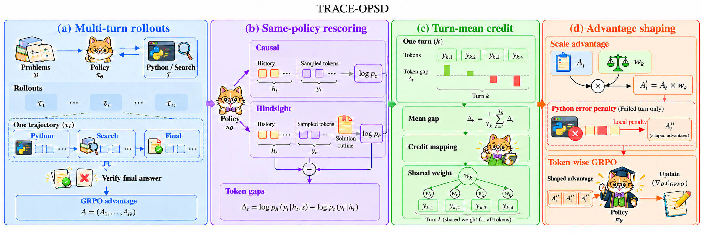
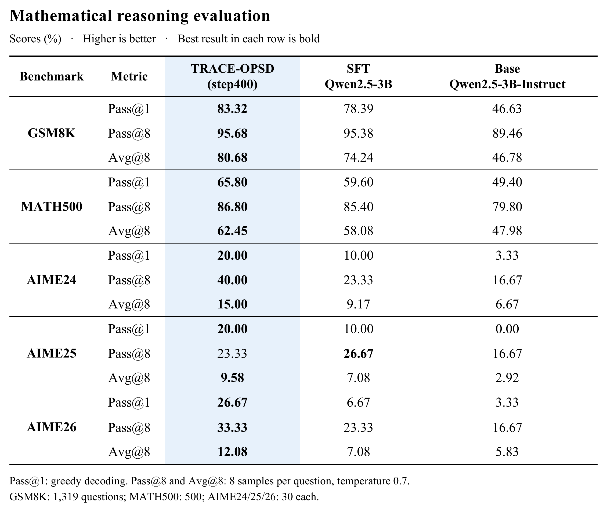
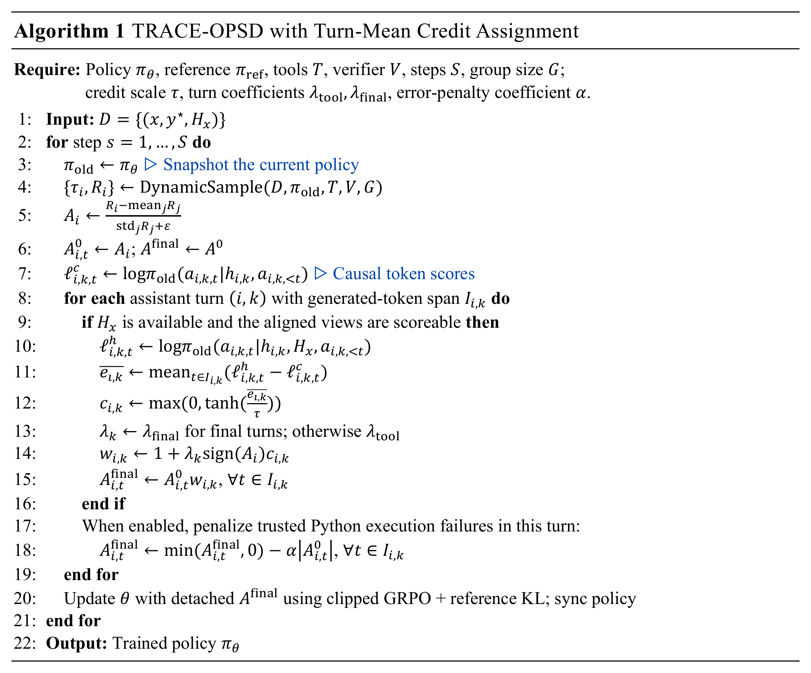

# Trace-OPSD

A post-training framework for multi-turn mathematical reasoning.




## Models and datasets

### Models

| Model | Hugging Face | Description |
|---|---|---|
| Trace-OPSD | [Trace-OPSD-Qwen2.5-3B](https://huggingface.co/BitZone910/Trace-OPSD-Qwen2.5-3B) | Mathematical reasoning model trained with TRACE-OPSD. |
| SFT | [SFT-Qwen2.5-3B](https://huggingface.co/BitZone910/SFT-Qwen2.5-3B) | Supervised fine-tuning model used to initialize TRACE-OPSD training. |

### Datasets and retrieval resources

| Resource | Hugging Face | Description |
|---|---|---|
| RL training data | [rl_trace_opsd](https://huggingface.co/datasets/BitZone910/rl_trace_opsd) | Mathematics problems with hindsight, including fixed training and validation splits. |
| SFT training data | [sft_math_tir](https://huggingface.co/datasets/BitZone910/sft_math_tir) | Tool-integrated mathematical reasoning examples for SFT. |

## Evaluation results



## Algorithm pseudocode



## Assets and runtime directories

```text
Trace-OPSD-workspace/
├── Trace-OPSD/                 # This source repository
├── assets/
│   ├── models/                
│   ├── datasets/sft/sft_math_tir.json
│   ├── datasets/numinamath/rl_trace_opsd.parquet
│   ├── datasets/grpo/         
│   ├── retrieval/general_search/{corpus,index}/
│   ├── wheels/               
│   └── runs/                 
└── records/                 
```

## Four launchers

```bash
export ASSETS=/root/autodl-tmp/assets
export WORK="$ASSETS/runs"

# 1. Set up the environment.
bash scripts/setup_env.sh --assets-root "$ASSETS" --work-root "$WORK" --gpu-count 4

# 2. Train on prepared TIR data.
bash scripts/run_sft.sh train --assets-root "$ASSETS" --work-root "$WORK" \
  --run-name sft-math --model-path "$ASSETS/models/Qwen2.5-3B-Instruct" \
  --dataset-file "$ASSETS/datasets/sft/sft_math_tir.json"

# 3. Run the first TRACE stage. The 16/16 difficulty mix is an example.
bash scripts/run_trace_curriculum.sh --assets-root "$ASSETS" --work-root "$WORK" \
  --run-name trace-math --model-path "$WORK/exports/sft/sft-math/final" \
  --after-step 0 --mid-per-step 16 --high-per-step 16 --resume none

# For subsequent stages, use the same run, the previous stage's final step,
# and the difficulty mix for the new stage:
# --after-step 50 --mid-per-step 16 --high-per-step 16 --resume latest

# 4. Evaluation.
mkdir -p "$WORK"
cp configs/evaluation/models.example.yaml "$WORK/evaluation-models.yaml"
# Edit model names, complete HF paths, and the optional baseline in this file.
bash scripts/run_eval_suite.sh --assets-root "$ASSETS" --work-root "$WORK" \
  --models-file "$WORK/evaluation-models.yaml" --protocol all \
  --output-root "$WORK/evaluation/math-comparison"
```
## Documentation 

- [SFT](docs/sft.md)
- [Trace-OPSD Algorithm](docs/trace-opsd-method.md)
- [Evaluation](docs/evaluation.md)
